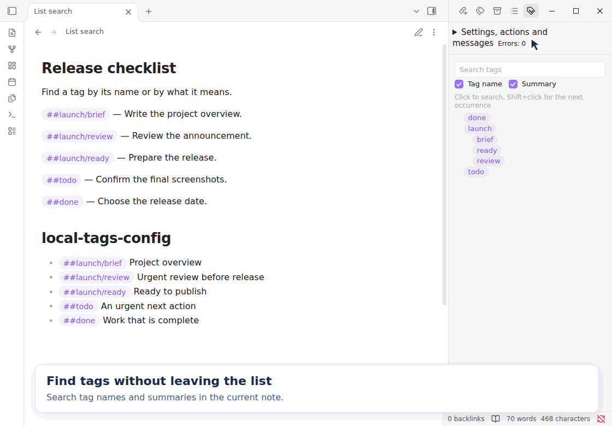
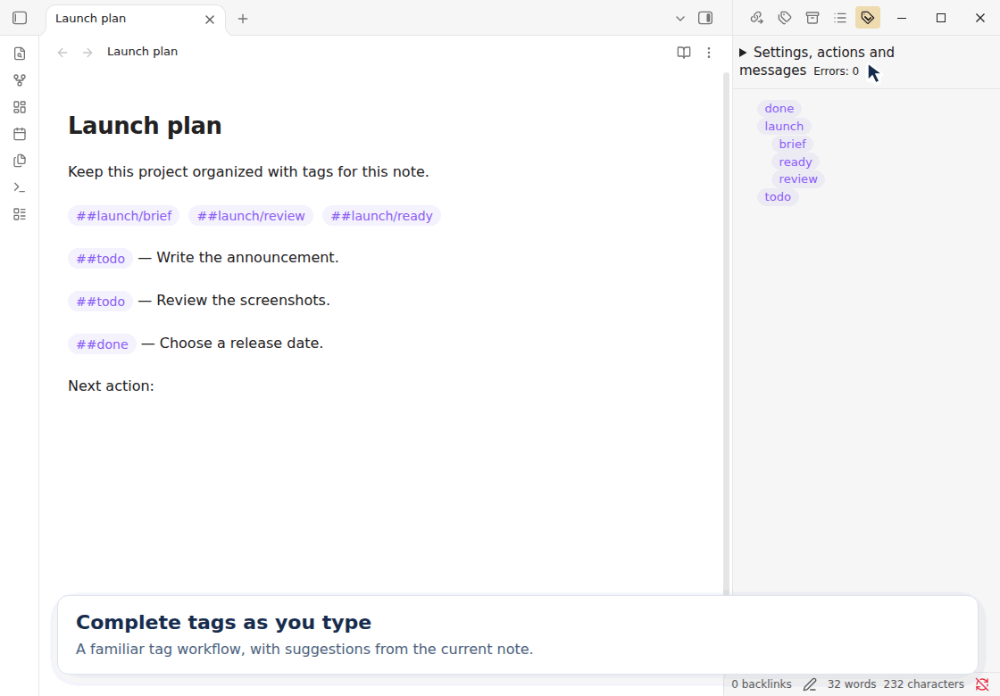
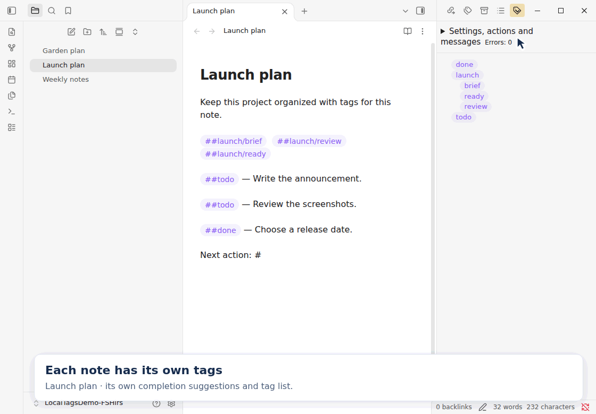
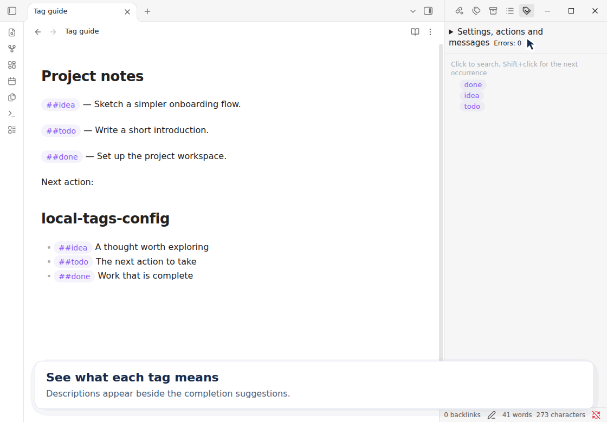
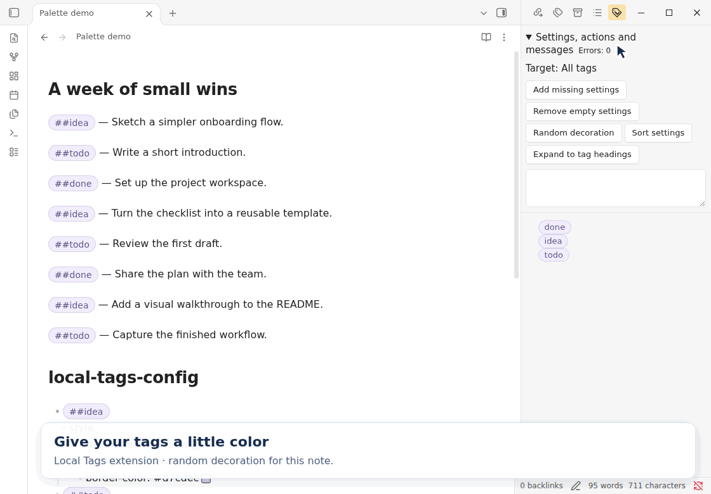
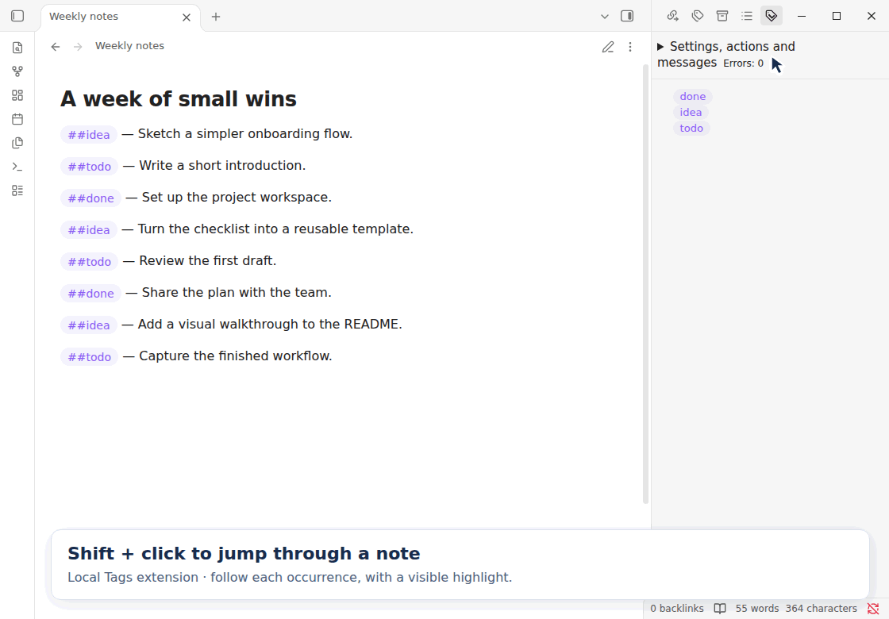
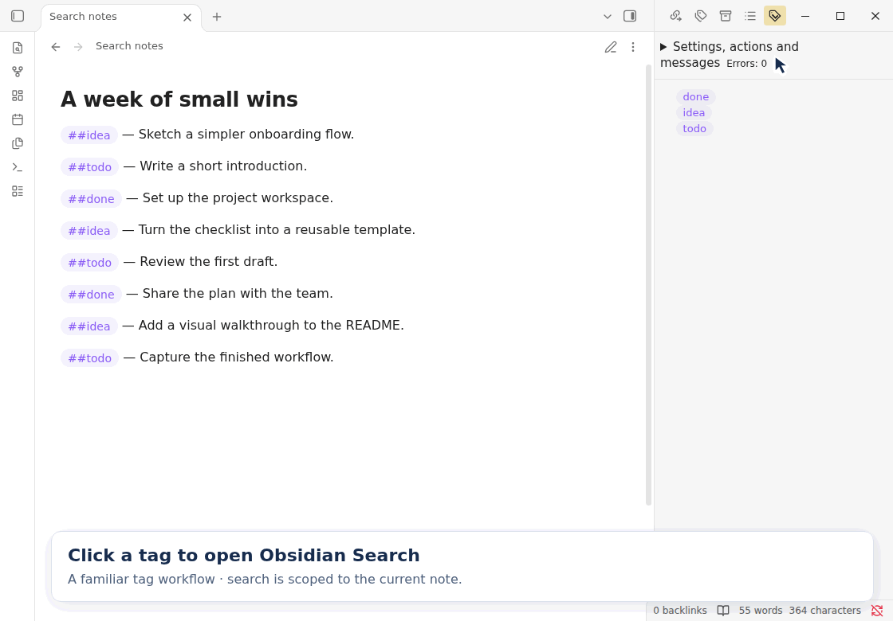

# Local Tags

Local Tags adds file-local `##tags` to Obsidian. Use the same tag name in different notes without mixing their completion suggestions or tag lists.

Check [Releases](https://github.com/mstksb/obsidian-local-tags/releases) for published packages. Community-plugin installation becomes available after the plugin has been accepted into Obsidian's community directory.

## Features

- Write tags such as `##project` and hierarchical tags such as `##people/Alex`.
- Complete tag names from the current Markdown file.
- Show per-note tag descriptions beside completion suggestions and in tooltips in the note and tag panel.
- Choose substring or prefix completion matching, with optional case sensitivity.
- Display tags in Source mode, Live Preview, and Reading View.
- Browse the current file's tags in a hierarchical panel and instantly filter them by name or description.
- Click a tag in the panel to search for its text within the current file.
- Shift+click a tag to cycle through its occurrences with a line highlight and an outline around the matching tag.
- Adjust the shared text color, background color, emphasis, and vertical padding in the plugin settings.
- Store per-note text, background, and border colors plus bold, underline, and italic settings under `local-tags-config`, with parent-to-child inheritance.
- Add missing settings, remove empty settings, generate vivid complementary colors, sort definitions, and expand the configuration to tag headings from the tag panel.
- Edit configuration colors through inline swatches in Source mode and Live Preview, and check configuration errors in the panel.

- Optionally hide `##` in Reading View and on inactive tags in Live Preview.

## See it in action

Completion, hierarchical tag lists, and click-to-search follow familiar tag interactions. Local Tags adds a separate vocabulary for each note, per-note random decoration, and Shift-click navigation.

### Filter the tag list as you type

Type in **Search tags** to narrow the current note's tag list immediately. Use the **Tag name** and **Summary** checkboxes to search names, descriptions, or both. Matching ignores case and keeps the ancestors of matching tags visible. Clear the search to restore the full list. See [Tag panel search](docs/usage.md#tag-panel-search) for details.



### Complete tags as you type

Type `##`, narrow the suggestions, and press Enter to insert a tag. Suggestions come from the current Markdown file. With substring matching, `##rev` finds `##launch/review`.



### Keep each note's tags local

Switch from Launch plan to Garden plan to see both the completion suggestions and the tag panel follow the active note. Standard `#tags` are indexed across the vault. Local `##tags` have a separate vocabulary in each file.



### Keep tag meanings close at hand

Add a short description after a tag declaration on the same line under `local-tags-config`. Descriptions appear beside completion suggestions and when you hover over a tag in the note or tag panel. Press Enter to insert just the tag. See [Tag descriptions](docs/usage.md#tag-descriptions) for the format.



### Add color with one click

Choose **Random decoration** to generate vivid complementary colors for the current note's tags. The demo uses Live Preview. Decoration settings are stored in the note's `local-tags-config` section.



### Shift-click to move between occurrences

Hold Shift and click a tag in the panel to visit its occurrences in the current note. A line highlight and an outline around the matching tag show the current position.



### Click to open Obsidian Search

Click a tag in the panel to open Obsidian's standard Search pane, with the current file and tag text filled in. Search results stay scoped to that note.



## Requirements

Desktop Obsidian `1.14.4` or later. Local Tags is a desktop-only plugin.

## Installation

For a locally built copy, place `main.js`, `manifest.json`, `styles.css`, `LICENSE`, and `THIRD-PARTY-NOTICES.txt` from `dist/local-tags/` into `<vault>/.obsidian/plugins/local-tags/` and enable **Local Tags** in Obsidian's community-plugin settings.

After replacing an installed build, disable and re-enable the plugin. If a new installation does not appear in the plugin list, reopen the vault.

## Quick start

1. Add `##project` or `##people/Alex` to a Markdown note.
2. Type `##` and part of an existing tag name, select a suggestion, and press Enter to accept it; press Esc to cancel.
3. Run the command **Open tag panel** to open the tag panel.
4. Click a tag in the panel to search the current file, or Shift+click to cycle through matching tags in the note.
5. Open **Settings → Local Tags** to adjust tag appearance.
6. For per-note decoration, expand **Settings, actions and messages** in the panel and choose **Add missing settings**. Fill in the generated values, or choose **Random decoration** to generate colors.

Local tags use `##` and are separate from Obsidian's standard `#tags`.

See [Usage](docs/usage.md) for input rules, recognition limits, shared appearance settings, per-note decoration, tag descriptions, panel actions, in-note navigation, and search caveats.

## Limitations

Basic use with English and Japanese text is expected to work, but has not been comprehensively verified. Behavior in other languages remains unverified.

## Build and test

Use Node.js 24 and npm:

```sh
npm ci --ignore-scripts
npm run check
```

The production build is written to `dist/local-tags/`. See [Development](docs/development.md) for individual checks and the release process.

## Project policy

This project does not accept pull requests. Bug reports are welcome through GitHub Issues and are handled on a best-effort basis. Feature requests may also be submitted, but have very low priority. Ongoing maintenance, support, and new features are not guaranteed.

## License

Copyright (C) 2026 mstksb.

The project's original code is licensed under the GNU General Public License, version 3 only (`GPL-3.0-only`). See [LICENSE](LICENSE) for the full terms. The complete license text is also embedded in the built `main.js` so it is retained when Obsidian installs only the runtime files.

Third-party components retain their respective licenses. Their notices are generated from the production bundle and included in `THIRD-PARTY-NOTICES.txt` and the built `main.js`.

## Documentation and updates

| File                                       | Purpose and update conditions                                                                                                                                                |
| ------------------------------------------ | ---------------------------------------------------------------------------------------------------------------------------------------------------------------------------- |
| [README.md](README.md)                     | Project overview, installation, basic operations, project policy, and document index; update when these change.                                                              |
| [AGENTS.md](AGENTS.md)                     | Project-specific editing instructions; update when the repository's working rules or references change.                                                                      |
| [docs/usage.md](docs/usage.md)             | Input rules, recognition limits, shared and per-note appearance settings, tag descriptions, panel actions, in-note navigation, and search caveats. Update when these change. |
| [docs/development.md](docs/development.md) | Build, test, manual checks, version preparation, and release procedure; update when those commands or processes change.                                                      |
| [CHANGELOG.md](CHANGELOG.md)               | User-visible changes for each release; update before preparing a release.                                                                                                    |
| [LICENSE](LICENSE)                         | License terms for the project's original code; keep licensing statements consistent with this file.                                                                          |
